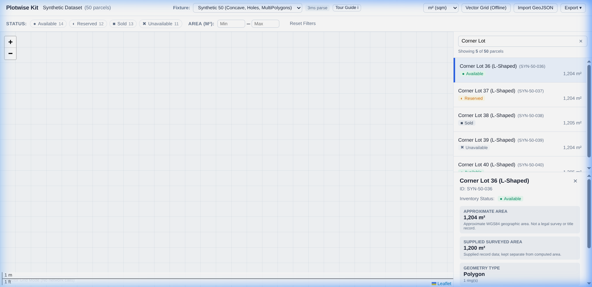

# Plotwise Kit

> A reusable, accessible parcel-viewing toolkit for developers. Load parcel polygons from GeoJSON and immediately provide an interactive map, keyboard-accessible list, status & area filters, selection synchronization, and safe export.



## Overview & Motivation

Building parcel viewer interfaces often requires cobbling together mapping libraries, custom polygon styling, area calculations, responsive lists, and URL sharing logic.

**Plotwise Kit** provides a coherent, lightweight developer toolkit that handles this end-to-end:
- **Offline & Zero-Config Baseline**: Simple vector grid mode runs completely without API keys, third-party tile dependencies, or external servers.
- **Strict GeoJSON Parcel Validation**: Enforces atomic validation for Polygon and MultiPolygon geometry with clear error diagnostics and downloadable reports.
- **Accurate Geographic Area**: Calculates approximate geographic area on the WGS84 sphere model (exterior ring minus interior holes), keeping surveyed title data distinct.
- **Visible Non-Color Status Cues**: Statuses (`available`, `reserved`, `sold`, `unavailable`) use text, distinct badge icons, and line stroke patterns for full accessibility.
- **High-Performance Canvas Rendering**: Renders up to 5,000+ parcels at 60fps without SVG DOM bloat or keyboard focus traps.
- **Safe Export**: Normalized GeoJSON and CSV inventory export with formula injection defense.

---

## Workspace Architecture

Plotwise Kit is organized as an npm workspace:

```text
plotwise-kit/
  packages/
    core/             # Pure TypeScript: validation, area calculation, filters, state
    react/            # React parcel viewer, Leaflet map, accessible virtual list, controls
  apps/
    demo/             # Vite demonstration application consuming public package exports
  examples/
    consumer/         # Minimal consumer testing package tarballs in isolated Node
  fixtures/           # Deterministic synthetic datasets (50, 500, 5,000) and invalid test cases
  docs/               # API, data schema, migration, and accessibility guides
  .github/workflows/  # Continuous integration definitions
```

---

## Quickstart

### Prerequisites

- Node.js LTS (`>= 20.0.0`, tested on `v22.23.1`)
- npm (`>= 10.0.0`)

### Installation & Demo Run

```bash
# 1. Clone repository and navigate to plotwise-kit
git clone <repo-url>
cd plotwise-kit

# 2. Install workspace dependencies
npm install

# 3. Run all unit and boundary tests
npm test

# 4. Launch the local interactive demonstration
npm run demo
```

The demonstration opens at `http://localhost:5173/` with sample synthetic datasets (50, 500, and 5,000 parcels).

---

## Minimal Integration Example

### 1. Pure Node / Backend Usage (`@kilwish1997/plotwise-core`)

```ts
import { parseParcelCollection, getParcelArea, formatArea } from '@kilwish1997/plotwise-core';

// Atomic parsing & validation
const result = parseParcelCollection(geoJsonData);

if (result.success) {
  const parcel = result.dataset.features[0];
  const areaSqm = getParcelArea(parcel, 'sqm');
  console.log(`Parcel: ${parcel.properties.label}`);
  console.log(`Computed Area: ${formatArea(areaSqm, 'ha')}`);
} else {
  console.error('Validation diagnostics:', result.diagnostics);
}
```

### 2. React Application (`@kilwish1997/plotwise-react`)

```tsx
import React from 'react';
import { parseParcelCollection } from '@kilwish1997/plotwise-core';
import { ParcelViewer } from '@kilwish1997/plotwise-react';
import '@kilwish1997/plotwise-react/styles.css';

// Parse your GeoJSON
const { dataset } = parseParcelCollection(geoJsonString);

export function App() {
  return (
    <div style={{ width: '100vw', height: '100vh' }}>
      <ParcelViewer
        dataset={dataset}
        onSelectParcel={(id) => console.log('Selected parcel:', id)}
      />
    </div>
  );
}
```

---

## Documentation

- [API Reference](docs/api.md) — Public exports, functions, and React component props.
- [Data Schema & Contracts](docs/data-schema.md) — Supported GeoJSON specs, validation rules, and error codes.
- [Migration Guide](docs/migration.md) — Migrating from hand-rolled Leaflet map implementations.
- [Accessibility Guide](docs/accessibility.md) — Keyboard navigation, screen-reader support, and non-color cues.
- [Release Checklist](RELEASE_CHECKLIST.md) — Verification and packaging procedures.
- [Evidence & Benchmarks](EVIDENCE.md) — Empirical performance measurements and verification records.

---

## Packaging Local Artifacts

To create clean `.tgz` npm packages and inspect their file contents:

```bash
npm run pack:all
```

Generated tarballs are deposited in `tarballs/`:
- `tarballs/kilwish1997-plotwise-core-0.1.0.tgz`
- `tarballs/kilwish1997-plotwise-react-0.1.0.tgz`

---

## Contributing & Security

Please see [CONTRIBUTING.md](CONTRIBUTING.md) and [SECURITY.md](SECURITY.md).

## License

MIT © [kilwish1997](https://github.com/kilwish1997)
